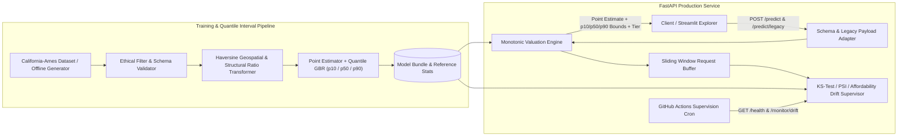

# Housing Valuation Pipeline

[](https://github.com/Rahul-git64/housing-valuation-pipeline/actions/workflows/ci.yml)
[](https://github.com/Rahul-git64/housing-valuation-pipeline/actions/workflows/cd-deploy.yml)
[](https://github.com/Rahul-git64/housing-valuation-pipeline/actions/workflows/supervision-cron.yml)
[](https://www.python.org/downloads/)
[](https://fastapi.tiangolo.com)

An end-to-end regional housing valuation pipeline that replaces the deprecated `sklearn.datasets.load_boston` schema with an ethical, modern **California & Ames Housing Schema**, Haversine geospatial feature engineering, **Quantile Regression prediction intervals (`p10`, `p50`, `p90`)**, FastAPI inference, and real-time covariate + **Income-to-Price Affordability Drift** supervision.

---

## System Architecture



---

## Key Engineering Upgrades

1. **Ethical & Modern Dataset Upgrade (California & Ames Schema + Legacy Adapter):**
   - Replaces `load_boston` (removed in `scikit-learn >= 1.2` due to demographic fairness flaws) with regional economic and structural features (`median_income`, `house_age`, `avg_rooms`, `avg_bedrooms`, `population`, `avg_occupancy`, `latitude`, `longitude`, `lot_area_sqft`, `overall_quality`, `ocean_proximity`).
   - Includes a backward-compatible `/predict/legacy` adapter (`adapt_legacy_boston_payload`) that translates legacy structural keys (`RM -> avg_rooms`, `AGE -> house_age`, `DIS -> proximity`) while explicitly stripping deprecated demographic columns (`B`, `LSTAT`).
2. **Haversine Geospatial & Structural Ratio Engineering:**
   - Computes vectorized great-circle Haversine distances (`dist_to_sf_km`, `dist_to_la_km`, `min_metro_distance_km`) to major regional economic hubs Alongside structural density ratios (`bedroom_to_room_ratio`, `rooms_per_person`, `income_per_room`, `log_lot_area`).
3. **Quantile Regression Valuation Intervals (`p10`, `p50`, `p90`):**
   - Trains candidate point estimators (`Ridge`, `RandomForestRegressor`, `GradientBoostingRegressor`) alongside three `GradientBoostingRegressor(loss="quantile")` models at $\alpha \in \{0.10, 0.50, 0.90\}$, enforcing non-crossing monotonic bounds ($p_{10} \le \hat{y} \le p_{90}$) at inference time.
4. **Covariate & Affordability Drift Supervision (`GET /monitor/drift`):**
   - Tracks two-sample Kolmogorov-Smirnov (`ks_2samp`) and Population Stability Index (PSI) across numerical housing features, $L_1$ divergence on `ocean_proximity`, and **Income-to-Price Ratio shift** (`predicted_price_usd / annual_income_usd`) to detect regional housing affordability drift.

---

## Holdout Model & Quantile Benchmarks

| Estimator / Component | $R^2$ | RMSE (USD) | MAE (USD) | MAPE (%) | Notes |
| :--- | :---: | :---: | :---: | :---: | :--- |
| **Ridge ($\alpha=1.5$)** | **0.9403** | **$31,800.67** | **$24,192.52** | **5.35%** | Selected Point Estimator |
| **GradientBoostingRegressor** | 0.9386 | $32,265.61 | $25,684.10 | 5.71% | Squared-error ensemble |
| **RandomForestRegressor** | 0.9292 | $34,643.61 | $27,994.45 | 6.27% | Bagged decision trees |
| **Quantile GBR ($\alpha = 0.10, 0.50, 0.90$)** | — | — | — | — | Pinball Loss: $p_{10}=\$6,663$, $p_{50}=\$13,237$, $p_{90}=\$6,717$; Median Width: $\$63,752$ |

---

## Project Layout

```text
housing-valuation-pipeline/
├── .github/workflows/
│   ├── ci.yml                  # Ruff, pytest, Docker build & container smoke test
│   ├── cd-deploy.yml           # Publishes verified image to GitHub Container Registry
│   └── supervision-cron.yml    # Daily automated health & affordability drift check
├── configs/
│   └── config.yaml             # Central configuration for data, quantiles, and drift
├── scripts/
│   ├── entrypoint.sh           # Container startup and auto-bootstrap script
│   ├── streamlit_app.py        # Interactive Streamlit valuation & interval explorer
│   └── train.py                # CLI training pipeline entrypoint
├── src/housing_valuation/
│   ├── api/
│   │   ├── main.py             # FastAPI service (/health, /predict, /predict/legacy, /monitor/drift)
│   │   ├── monitoring.py       # KS-test, PSI, and income-to-price ratio drift supervisor
│   │   └── schemas.py          # Pydantic v2 request/response contracts
│   ├── core/
│   │   ├── config.py           # Typed YAML configuration loader
│   │   ├── exceptions.py       # Custom domain exception hierarchy
│   │   └── logger.py           # Structured JSON logger
│   ├── data/
│   │   ├── ingestion.py        # Deterministic offline California-Ames generator & loader
│   │   ├── preprocessing.py    # Haversine distance & structural ratio sklearn transformer
│   │   └── validation.py       # Schema validation & legacy Boston payload adapter
│   └── models/
│       ├── registry.py         # Monotonic quantile predictor & market tier classifier
│       └── trainer.py          # Point + quantile regression trainer and evaluator
├── tests/
│   ├── test_api.py             # FastAPI endpoint, legacy adapter & drift integration tests
│   ├── test_data_pipeline.py   # Validation, ethical stripping & Haversine unit tests
│   └── test_model_trainer.py   # Quantile training & monotonic bound unit tests
├── Dockerfile
├── pyproject.toml
└── README.md
```

---

## Local Setup & Quickstart

### 1. Install Dependencies

```bash
pip install -e ".[dev]"
```

### 2. Run the Training Pipeline

```bash
python scripts/train.py
```

### 3. Launch the FastAPI Service

```bash
uvicorn housing_valuation.api.main:app --host 0.0.0.0 --port 8000 --reload
```

### 4. Launch the Streamlit Valuation Explorer

```bash
streamlit run scripts/streamlit_app.py
```

### 5. Run Linter & Test Suite

```bash
ruff check .
pytest -v
```

---

## Docker Usage

### Build & Run Locally

```bash
docker build -t housing-valuation-pipeline:latest .
docker run -d --name housing-api -p 8000:8000 housing-valuation-pipeline:latest
```

### Pull from GitHub Container Registry (GHCR)

```bash
docker pull ghcr.io/rahul-git64/housing-valuation-pipeline:latest
docker run -p 8000:8000 ghcr.io/rahul-git64/housing-valuation-pipeline:latest
```

---

## API Reference

### `POST /predict`

```bash
curl -s -X POST http://localhost:8000/predict \
  -H "Content-Type: application/json" \
  -d '{
    "median_income": 6.8,
    "house_age": 22.0,
    "avg_rooms": 6.2,
    "avg_bedrooms": 1.2,
    "population": 1150.0,
    "avg_occupancy": 2.7,
    "latitude": 37.7749,
    "longitude": -122.4194,
    "lot_area_sqft": 5800.0,
    "overall_quality": 7,
    "ocean_proximity": "NEAR BAY"
  }' | jq
```

```json
{
  "predicted_price_usd": 621480.5,
  "price_p10_usd": 589120.15,
  "price_p50_usd": 622910.4,
  "price_p90_usd": 654310.85,
  "valuation_tier": "Luxury",
  "income_to_price_ratio": 9.139,
  "confidence_score": 0.942,
  "model_name": "Ridge+QuantileGBR",
  "model_version": "0.1.0",
  "latency_ms": 3.412
}
```

### `GET /monitor/drift`

Returns KS-test $p$-values and Population Stability Index (PSI) across numerical housing features, categorical $L_1$ divergence on `ocean_proximity`, and `income_to_price_ratio_drift`.

---

## License

Distributed under the MIT License.
